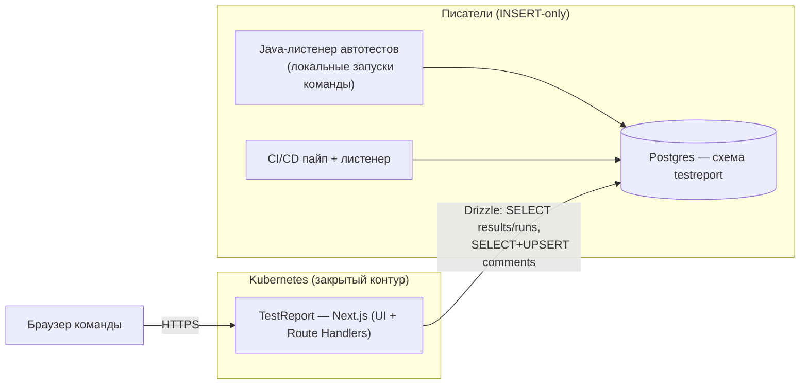
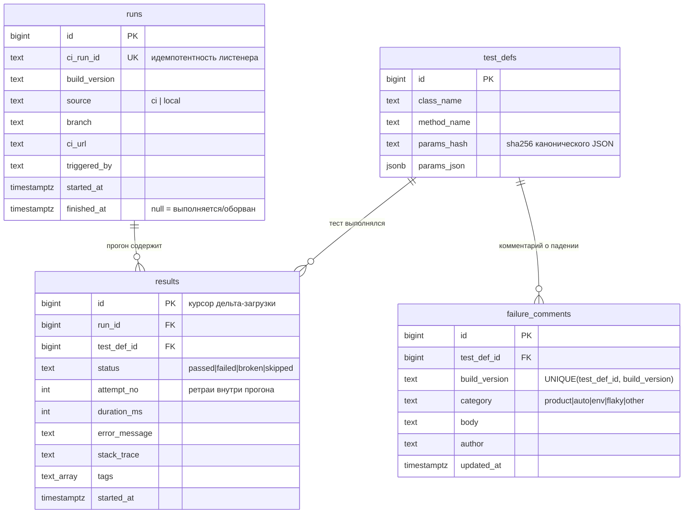

# TestReport — сервис отчётности по автотестам

**Статус:** архитектура v2 + рабочий MVP-каркас (проверен на демо-данных)
**Дата:** 2026-10-06
**Уточнения зафиксированы:** схема БД проектируется с нуля; авторизация не нужна (закрытый контур, доступ всей команде); ключ теста — класс + метод + параметры; **результаты пишут в БД напрямую листенер автотестов (локальные запуски команды и CI/CD)**.

---

## 1. Контекст и цель

Allure-отчёты не закрывают потребности команды:

- не поддерживают **перезапуски** (rerun падавших тестов в рамках периода отчёта);
- не имеют **комментариев** о причинах падения;
- не умеют собирать отчёт **по версии билда** за произвольный период с группировкой причин падений.

Цель сервиса — брать результаты автотестов из Postgres за период и давать:

1. общий отчёт с фильтрами: статус, тестовый класс/метод, теги, сообщение об ошибке;
2. комментарии к упавшим тестам (категория + текст) и массовое комментирование;
3. сводку по билду: сколько прошло / упало / «починено после перезапуска», с группировкой причин падений по комментариям;
4. учёт перезапусков: если тест в рамках билда прошёл хотя бы один раз после падения — статус «починен»;
5. **сравнение прогонов**: если пайп оборвался на середине двухчасового прогона — список тестов, отсутствующих в текущем прогоне по сравнению с предыдущим отчётом, готовый к перезапуску;
6. **инкрементальную догрузку**: срез по билду грузится целиком один раз, дальше — только дельта с момента последней загрузки (принудительная полная загрузка — по кнопке).

**Не-цели MVP:** анализ нестабильных (flaky) тестов, хранение эталонных скриншотов (заложено в модель, реализация после MVP), интеграции с трекерами.

---

## 2. Объёмы и ограничения

| Параметр | Значение | Вывод для архитектуры |
|---|---|---|
| Тестов за прогон | ~4000 | ответ отчёта ≈ 2 МБ JSON (gzip ≈ 350 КБ), фильтры на клиенте |
| Параллельных потоков автотестов | ≤ 10 | нагрузка мизерная: 1 реплика, Redis/Kafka не нужны |
| Источник данных | Postgres, **прямая запись листенером** | сервис только читает results/runs и пишет comments |
| Прогон | до 2 часов, результаты дописываются по ходу | `finished_at = null` у идущего прогона; отчёт живёт через дельта-загрузку |
| Развёртывание | Kubernetes, минимум ресурсов | один контейнер Next.js standalone, requests 100m/256Mi |
| S3 | недоступен | скриншоты — на PVC (после MVP), ~40 МБ/мес |
| Авторизация | не нужна (закрытый контур) | но UI не должен уметь удалять результаты — см. «Безопасность» |

---

## 3. Ключевые архитектурные решения

| Решение | Обоснование |
|---|---|
| **Один язык TypeScript на фронт и бек** | упор на фронтенд; общий типизированный контракт (Zod-схемы валидируют API и типизируют клиент) |
| **Next.js (App Router) — единый сервис: UI + API** | один деплоймент в K8s; Route Handlers = тонкий бекенд только для чтения и комментариев |
| **Запись — напрямую из листенера автотестов** | Java-листенер (локальные запуски и CI) вставляет `runs`/`results`/`test_defs` в БД по ходу прогона; сервис не является обязательным посредником на пути данных — отчёты работают, даже если UI-сервис лежит |
| **Результаты immutable** | ни сервис, ни UI не перезаписывают и не удаляют результаты; «починен» и агрегаты **вычисляются при чтении**. Единственная запись сервиса — `failure_comments` |
| **Идемпотентность листенера по `ci_run_id`** | повторный старт/ретрай не создаёт дублей (`UNIQUE` + `ON CONFLICT DO NOTHING`) |
| **Дельта-загрузка по курсору `max_result_id`** | данные append-only, id монотонно растёт → «догрузить с момента последней загрузки» = `WHERE id > :cursor`; полный срез — только по кнопке или при пустом кеше |
| **Ключ дедупликации теста: класс + метод + параметры** | параметризованные тесты — отдельные экземпляры (`params_hash` = sha256 канонического JSON) |
| **Комментарий на пару (тест, версия билда)** | группировка причин = категория + нормализованный текст; массовое применение одним batch-запросом |
| **Без Redis / Kafka / S3** | подтверждено оценками нагрузки; чем меньше движущихся частей, тем выше надёжность в закрытом контуре |
| **Вычисления на клиенте** | фильтрация/группировка среза (≤ ~5 тыс. строк) — в браузере; сервер остаётся тонким |

---

## 4. Стек и обоснование (приоритет: безопасность и поддерживаемость)

| Слой | Выбор | Почему |
|---|---|---|
| Язык | **TypeScript** (strict) | один язык на фронт/бек; типобезопасный контракт; крупнейшая экосистема UI |
| Фреймворк | **Next.js 15, App Router** | де-факто стандарт React; один образ на UI и API; предсказуемые LTS-патчи безопасности |
| UI | **React + собственная виртуализированная таблица**, CSS на чистых переменных | 4000+ строк без пагинации без тяжёлых зависимостей; минимум supply-chain surface |
| БД-слой | **Drizzle ORM** + drizzle-kit | SQL-first, полностью типизирован, все запросы параметризованы (анти-SQL-инъекции) |
| Драйвер PG | **postgres.js** (c парсером `int8 → number`) | append-only id (int8) везде приводится к number — рантайм совпадает с типами TS |
| Валидация | **Zod** | каждая входная точка API валидирует вход; те же схемы — на клиенте |
| Тесты сервиса | Vitest (unit) + Playwright (E2E) | знакомо QA-команде |
| Менеджер пакетов | npm workspaces + lockfile | без дополнительных инструментов; `npm audit` в CI |

**Отклонённые альтернативы:** Java (Spring) + React — два языка и два деплоя ради тонкого бекенда; Go + HTMX — беднее экосистема для rich-table UX; Python (FastAPI) + React — снова два языка.

---

## 5. Обзор системы



Поток данных:

1. Листенер на старте прогона вставляет строку в `runs` (`ci_run_id` = UUID, `finished_at = null`).
2. По завершении каждого теста — `INSERT ... ON CONFLICT DO NOTHING` в `results` (+ `test_defs` по ключу класс+метод+`params_hash`). Пайп может умереть в любой момент: данные не теряются, прогон остаётся «незавершённым».
3. Пользователь открывает отчёт: первый раз — полный срез по билду (`/api/report`), кеш в localStorage с курсором `maxResultId`; обновления — только дельта (`/api/delta?afterId=…`).
4. Идущий прогон виден в UI (бейдж «выполняется»), автообновление раз в 15 с догружает новые результаты.
5. Если прогон оборвался — кнопка «Отсутствуют…» показывает тесты, которых нет относительно предыдущего полного прогона; список копируется в буфер для перезапуска.

---

## 6. Контракт записи данных (для Java-листенера)

Листенер пишет только `INSERT` в три таблицы. Минимальный контракт:

**1) Старт прогона:**

```sql
insert into testreport.runs
  (ci_run_id, build_version, source, branch, ci_url, triggered_by, started_at)
values
  ($uuid, $build, 'ci'|'local', $branch, $ciUrl, $user, now())
-- запомнить id прогона
```

**2) Завершение каждого теста:**

```sql
insert into testreport.test_defs (class_name, method_name, params_hash, params_json)
values ($cls, $method, $paramsHash, $paramsJson::jsonb)
on conflict (class_name, method_name, params_hash) do nothing;

insert into testreport.results
  (run_id, test_def_id, status, attempt_no, duration_ms, error_message, stack_trace, tags, started_at)
values ($runId, $defId, $status, $attemptNo, $dur, $err, $stack, $tags::text[], now())
on conflict do nothing;
```

- `status` ∈ `passed | failed | broken | skipped`;
- `attempt_no` — ретраи теста внутри одного прогона (по умолчанию 1);
- `params_hash` = sha256 канонического JSON параметров (`''` для непараметризованных);
- ретрай листенера безопасен: `ci_run_id` уникален, конфликты глушатся `ON CONFLICT DO NOTHING`.

**3) Финиш прогона:** `update testreport.runs set finished_at = now() where id = $id` — необязателен для отчёта: незавершённый прогон просто помечается «выполняется», а сравнение с предыдущим полным прогоном выявляет обрыв.

Требование к роли БД листенера: `INSERT` на `runs/results/test_defs` + `SELECT` на `test_defs` (разрешение конфликтов). Без `UPDATE`/`DELETE`.

---

## 7. Модель данных



DDL воспроизводится из кода: `app/src/db/schema.ts` (Drizzle) + `npm run db:push`. Индексы: `results(test_def_id, started_at)`, `results(run_id)`, `runs(build_version, started_at desc)`; таблицы `attachments` и `baselines` под скриншоты — после MVP (см. §14).

### 7.1. Вычисление статуса при чтении

Агрегация выполняется на сервере (SQL compact-запрос) и на клиенте (одна и та же чистая функция `resolveStatus`, покрыта общими типами):

```
последняя попытка (по started_at, attempt_no) выигрывает:
  last = passed  и были падения в срезе → fixed («починен»)
  иначе → last.status (passed | failed | broken | skipped)
```

Исходные попытки не перезаписываются: drill-down в карточке теста показывает каждую попытку с источником (CI/локальный), веткой, автором запуска и stack trace.

---

## 8. Комментарии и группировка причин падений

- Комментарий живёт на паре **(test_def, build_version)** — один редактируемый комментарий на тест на билд; категория обязательна: `product | auto | env | flaky | other`.
- **Группировка причин в сводке по билду:** упавшие строки группируются по ключу `category + normalize(body)` (trim, схлопывание пробелов, lowercase). Тесты без комментария образуют группу «Без комментария» — сразу видно, что не разобрано.
- Массовое применение: чекбоксы строк → один PUT `/api/comments` со списком `testDefIds` (до 500 за раз).
- Автор указывается вручную (localStorage подставляет имя) — достаточно без авторизации; при появлении SSO поле заполнится из токена.

---

## 9. API сервиса

| Метод | Путь | Назначение |
|---|---|---|
| GET | `/api/healthz` | liveness/readiness для K8s |
| GET | `/api/builds` | версии билдов с числом прогонов и периодами |
| GET | `/api/runs` | последние прогоны (для селектора базы сравнения) |
| GET | `/api/report?build` | полный срез: прогоны + компактные результаты + словарь тестов + `maxResultId` |
| GET | `/api/delta?build&afterId` | **дельта**: только результаты с `id > afterId` + актуальные прогоны + новый курсор |
| GET | `/api/attempts?testDefId&build` | все попытки теста (drill-down с ошибками и трейсами) |
| GET | `/api/comments?build` | комментарии билда |
| PUT | `/api/comments` | upsert комментария одному или списку тестов (единственная запись) |
| GET | `/api/missing?runId[&baselineRunId]` | тесты, отсутствующие в прогоне относительно базового (для перезапуска после обрыва) |

Все входы валидируются Zod; DELETE-эндпоинтов нет вообще.

**Выбор авто-базы в `/api/missing`:** среди прогонов, начавшихся раньше текущего, берётся прогон с наибольшим покрытием (distinct тестов), прогоны того же билда приоритетны — обрыв сравнивается с последним **полным** отчётом, а не с рераном. Базу можно переопределить вручную в UI.

**Дельта-загрузка на клиенте:** срез кешируется в `localStorage` (`{results, testDefs, runs, maxResultId}`, лимит ~4 МБ). «Обновить» → `/api/delta?afterId=курсор` → merge по id → новый курсор. «Полная перезагрузка» стирает кеш и тянет срез целиком. Автообновление (15 с) использует ту же дельту — отчёт живёт по ходу двухчасового прогона.

---

## 10. Фронтенд

| Экран | Содержимое |
|---|---|
| Дашборд `/` | селектор билда; счётчики-фильтры (passed/fixed/failed/broken/skipped/всего); панель прогонов с кнопкой «Отсутствуют…»; группы причин падений (клик → фильтр); виртуализированная таблица; тулбар фильтров |
| Drawer теста | сводка, комментарий (просмотр + форма), все попытки с ошибками, stack trace, источник каждой попытки |
| Модалка «Отсутствующие тесты» | выбор базы сравнения, счётчик, список `Class.method`, копирование списком или строкой `-Dtest=…` для перезапуска |
| Bulk-панель | чекбоксы → панель массового комментария внизу экрана |

Фильтры (все клиентские, мгновенные): статус (клик по счётчику/чипу), поиск по классу/методу, поиск по тексту ошибки, мультивыбор тегов (топ-24 по частоте), фокус на группе причин.

---

## 11. Безопасность

Авторизации нет (закрытый контур, осознанное решение), поэтому упор — в целостность данных и готовность добавить auth потом:

1. **UI не может стереть результаты — на трёх уровнях:** в API нет DELETE/PUT для `runs`/`results`; роль БД сервиса имеет только `SELECT` на них (и `INSERT/UPDATE` на `failure_comments`); результаты immutable по дизайну — «починен» вычисляется, а не записывается.
2. **Роль листенера отдельно от роли сервиса** — писатели не могут читать комментарии, сервис не может писать результаты.
3. **Готовность к авторизации:** единая точка — `middleware.ts`; включение OIDC/сессий позже не меняет архитектуру.
4. **SQL-инъекции:** Drizzle — только параметризованные запросы; Zod-валидация всех входов (типы, длины, enum-статусы, `body ≤ 4000`).
5. **XSS:** React экранирует по умолчанию, `dangerouslySetInnerHTML` не используется; заголовки `X-Frame-Options`, `X-Content-Type-Options`, `Referrer-Policy` уже в `next.config.ts`.
6. **Контейнер:** multi-stage, non-root, read-only root fs, dropped capabilities, сканирование Trivy.
7. **Supply chain:** lockfile, Dependabot/Renovate, `npm audit` в CI, базовый образ по digest.

---

## 12. Развёртывание в Kubernetes

Один Deployment; Postgres — существующий инстанс, сервис владеет схемой `testreport`.

```yaml
apiVersion: apps/v1
kind: Deployment
metadata: { name: testreport }
spec:
  replicas: 1            # MVP; 2 — когда понадобится отказоустойчивость
  template:
    spec:
      securityContext: { runAsNonRoot: true }
      containers:
        - name: web
          image: registry.internal/testreport:1.0.0   # digest-фиксация в prod
          ports: [{ containerPort: 3000 }]
          envFrom:
            - secretRef: { name: testreport-secrets } # DATABASE_URL
          readinessProbe: { httpGet: { path: /api/healthz, port: 3000 } }
          livenessProbe:  { httpGet: { path: /api/healthz, port: 3000 } }
          resources:
            requests: { cpu: 100m, memory: 256Mi }
            limits:   { cpu: 500m, memory: 512Mi }
          securityContext:
            readOnlyRootFilesystem: true
            allowPrivilegeEscalation: false
```

Ingress с TLS; NetworkPolicy (egress → Postgres, DNS); PVC 1 GiB под скриншоты — после MVP. Локально и для демо — `deploy/docker-compose.yml` (Postgres 16).

### Структура репозитория (фактическая)

```
testreport/
├── app/                # Next.js: UI + Route Handlers
│   └── src/
│       ├── app/        # страница дашборда и /api/*
│       ├── db/         # drizzle-схема, клиент, запросы
│       ├── lib/        # статусы/агрегации, zod-контракты, кеш, api-типы
│       └── components/ # Dashboard, ReportTable, TestDrawer, MissingModal, ...
├── generator/          # генератор демо-данных (имитация листенера: батч-INSERT)
├── deploy/             # docker-compose (Postgres), k8s-манифесты (после MVP)
└── docs/               # этот документ, скриншоты
```

---

## 13. Производительность и объёмы

| Метрика | Оценка | Комментарий |
|---|---|---|
| Строк `results` | 4000/прогон; ≈ 2.4 млн/мес при 20 прогонах/день | тривиально для PG; retention/партиции — пост-MVP |
| Полный срез билда | ~2 МБ JSON (gzip ≈ 350 КБ), один раз | дальше только дельта — килобайты |
| Ответ `/api/delta` | пропорционален приросту | live-прогон: десятки строк за 15 с |
| Память приложения | 200–300 МБ RSS | лимит 512Mi с запасом |
| First Load JS | 110 kB | измерено на сборке MVP |

---

## 14. После MVP (заложено в архитектуру)

1. **Эталонные скриншоты:** листенер отправляет скриншот упавшего шага в `attachments` (файл на PVC, метаданные в БД). В UI: эталон/актуальный side-by-side, «Обновить эталон» → новая версия в `baselines` — без правок кода тестов; старые версии сохраняются для отката.
2. **Flaky-анализ:** данные уже копятся в `results` — pass-rate по билдам за N дней, страница `/flaky` с ранжированием.
3. SSO при появлении требования; тренды pass-rate по билдам; экспорт сводки в Markdown/Excel.

---

## 15. MVP-каркас — что уже работает (проверено)

Каркас собран и проверен на демо-данных (скриншоты в `docs/screens/`):

- схема БД + миграции (`npm run db:push`);
- API: builds, runs, report, **delta**, attempts, comments (GET/PUT, batch), **missing**, healthz — проверены curl/нодой на живой БД;
- UI: дашборд с счётчиками-фильтрами, панель прогонов с бейджем «выполняется», группы причин, виртуализированная таблица (2880–4000 строк), drawer с попытками и комментарием, модалка «Отсутствуют…» (1120 = 4000 − 2880, сходится точно), bulk-комментарий;
- дельта-загрузка с кешем в localStorage и курсором `maxResultId` (+ «Полная перезагрузка»);
- генератор демо-данных: 3 билда — 2.7.0 (CI + реран), 2.8.0 (CI + локальный реран Дмитрия → 110 «починено»), 2.9.0 (оборван на 62%, затем дописан `--progress` → дельта пришла без дублей);
- typecheck и prod-сборка проходят; first load 110 kB.

Оценка до презентации: докрутить полировку UI и E2E-сценарий — 3–5 вечеров.

**Сценарий демо:** билд 2.9.0 идёт (бейдж «выполняется») → «Отсутствуют…» на оборванном прогоне → копируем `-Dtest=…` → `npm run demo:progress` имитирует дописывание → «Обновить» приносит только дельту → переключаемся на 2.8.0: «Починен 110», группы причин по категориям, массовый комментарий упавших без комментария.

---

## 16. Риски и открытые вопросы

| Риск / вопрос | Митигирование |
|---|---|
| Листенер пишут «вслепую», пока UI лежит | данные append-only и идемпотентны; отчёт пересчитывается при чтении — ничего не теряется |
| Листенер шлёт некорректные статусы/теги | CHECK-констрейнты в БД + Zod на чтении; битые строки видны в UI как «Ошибка» |
| Рост `results` (>30 млн/год) | retention-джоба или партиции по месяцам — пост-MVP, индексы уже есть |
| localStorage-кеш переполнен (кеш-лимит ~4 МБ) | молча пропускаем запись кеша → следующий заход делает полную загрузку |
| Один разработчик (bus factor) | один сервис, один язык, документ в репозитории |
| Отдельные страницы Allure (шаги) всё ещё нужны | TestReport не заменяет Allure, а агрегирует; шаги можно добавить позже (`steps jsonb` в `results`) |
